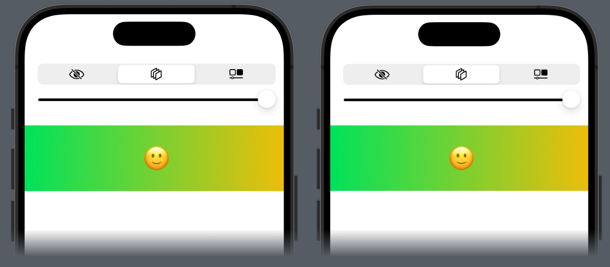
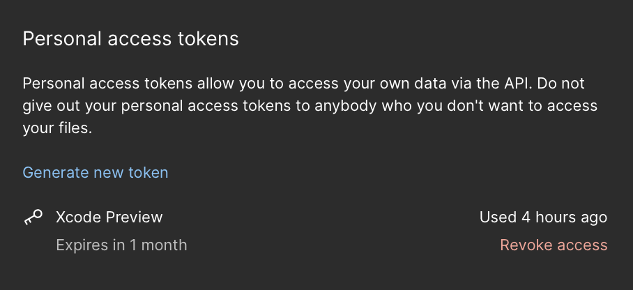

# Figma Preview

[](https://swiftpackageindex.com/artemnovichkov/figma-preview)
[](https://swiftpackageindex.com/artemnovichkov/figma-preview)


<p align="center">
  
</p>

Figma Preview is a Swift library designed to streamline the integration of Figma designs into your Xcode Preview. It allows developers to preview UI components directly from Figma files, facilitating a smoother design-to-code transition and ensuring that your app's UI matches the design specifications with precision.

## Features

- **Direct Preview:** Instantly preview Figma designs in your Xcode Preview.
- **Concise Preview Macro:** Compare a view with a Figma reference without repeating the modifier setup.
- **Easy Integration:** Seamlessly integrates with Xcode, leveraging Swift Package Manager for straightforward installation.
- **Design Sync:** Keep your application's UI in sync with the latest design changes in Figma.

## Requirements

- Xcode 15.3 or later
- Swift 5.10 or later
- iOS 15 or later
- macOS 12 or later

## Installation

### Swift Package Manager

You can add Figma Preview to an Xcode project by adding it as a package dependency.

1. In Xcode, select `File > Add Package Dependencies...`.
2. Enter the package repository URL: `https://github.com/artemnovichkov/figma-preview.git`
3. Specify the version rules that make sense for your project.

## Usage

### Importing the Library

Import SwiftUI and FigmaPreview into your Swift file:

```swift
import Foundation
import SwiftUI
import FigmaPreview
```

### Preview Trait

On Xcode 16 or later, use the standard `#Preview` macro with the `.figma` trait. `PreviewModifier` applies the comparison UI around the preview content while preserving the standard preview macro and its other traits.

```swift
@available(iOS 18.0, macOS 15.0, *)
#Preview(
    "Content",
    traits: .figma(Image(.component), previewState: .compare)
) {
    ContentView()
        .frame(width: 400, height: 100)
}
```

The availability annotation is required when the app's deployment target is lower than iOS 18 or macOS 15. The existing `compare` modifier and `#Preview(with:)` macro remain available for earlier toolchains.

For a remote Figma component, pass the token directly to the trait. Store the token in the preview scheme's environment instead of source control:

```swift
@available(iOS 18.0, macOS 15.0, *)
#Preview(
    traits: .figma(
        URL(string: "https://www.figma.com/design/<file-id>/Untitled?node-id=<component-id>")!,
        accessToken: ProcessInfo.processInfo.environment["FIGMA_ACCESS_TOKEN"] ?? "",
        previewState: .layers
    )
) {
    ContentView()
}
```

### Preview Macro

Figma Preview overloads SwiftUI's `#Preview` macro with a `with:` argument. The optional name and `previewState` parameters follow the standard preview syntax:

```swift
#Preview("Content", with: Image(.component), previewState: .compare) {
    ContentView()
        .frame(width: 400, height: 100)
}
```

The default preview state is `.hidden`, so it can be omitted:

```swift
#Preview(with: Image(.component)) {
    ContentView()
}
```

Remote macro previews require the token explicitly, just like the preview trait:

```swift
#Preview(
    "Remote",
    with: URL(string: "https://www.figma.com/design/<file-id>/Untitled?node-id=<component-id>")!,
    accessToken: ProcessInfo.processInfo.environment["FIGMA_ACCESS_TOKEN"] ?? "",
    previewState: .layers
) {
    ContentView()
}
```

Export final components from Figma as PNG files and save them in `Preview Assets.xcassets`. Assets in a development asset catalog are available to previews and debug builds, but are excluded from archives. See [Build programmatic UI with Xcode Previews](https://developer.apple.com/videos/play/wwdc2023/10252) from WWDC23 for details.

### Remote Figma Components

Remote components require a Figma access token. Apply the token after `compare` so it is available to the Figma preview modifier.

Using a Figma component URL:

```swift
#Preview {
    ContentView()
        .compare(with: URL(string: "https://www.figma.com/file/<file-id>/Untitled?node-id=<component-id>")!)
        .environment(\.figmaAccessToken, "<figma-access-token>")
}
```

Select a component in Figma's Layers panel and use `Copy/Paste as > Copy link` to copy its URL.

Using separate file and component IDs:

```swift
#Preview {
    ContentView()
        .compare(with: "<file-id>", componentID: "<component-id>")
        .environment(\.figmaAccessToken, "<figma-access-token>")
}
```

You can extract both IDs from the Figma component URL.

Generate a personal access token from `Figma > Help and account > Account settings`:

<p align="center">
  
</p>

## Preview Options

Figma Preview adds a panel with three display modes:

1. **Hidden:** Hides the reference while you work on the view.
2. **Layers:** Places the reference over the view with adjustable opacity.
3. **Compare:** Shows a movable slider for side-by-side comparison.

Open the `FigmaPreviewExample` project to try it yourself.

## Contributing

I welcome contributions! If you would like to help improve Figma Preview, please submit a pull request or open an issue for discussion.

## Author

Artem Novichkov, https://www.artemnovichkov.com/

## License

The project is available under the MIT license. See the [LICENSE](./LICENSE) file for more info.
